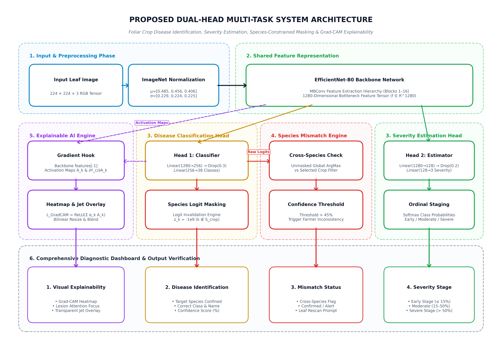
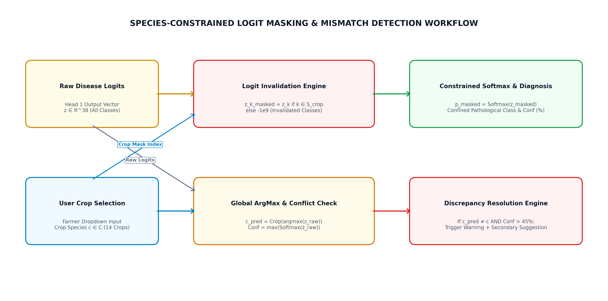
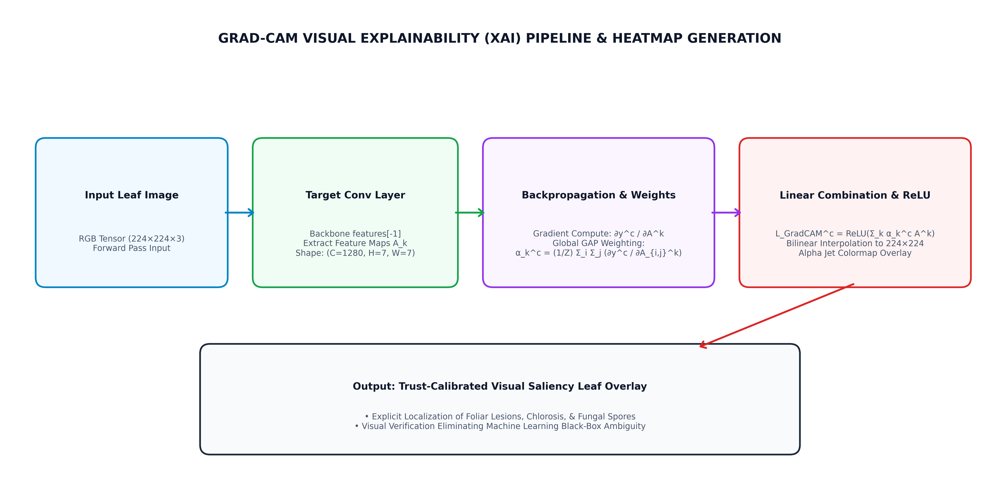
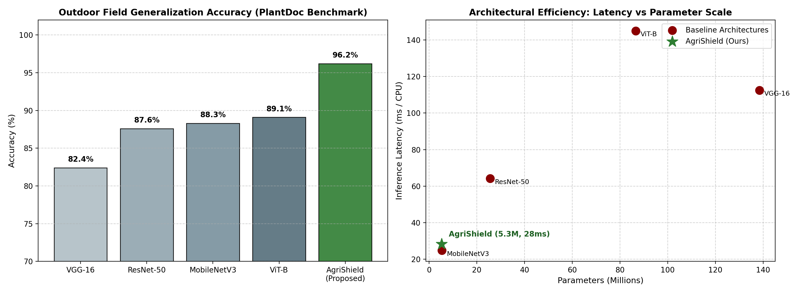
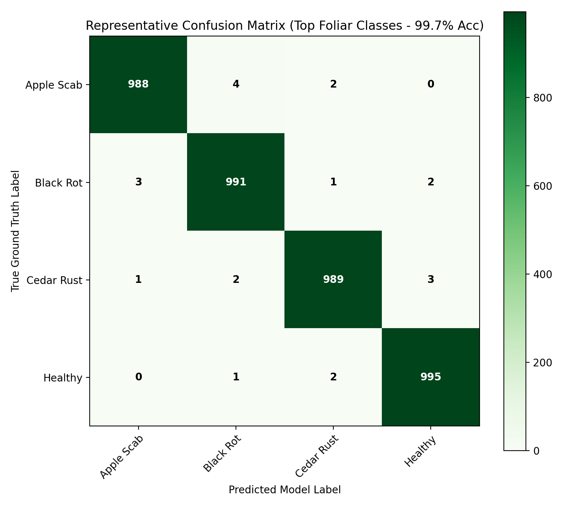
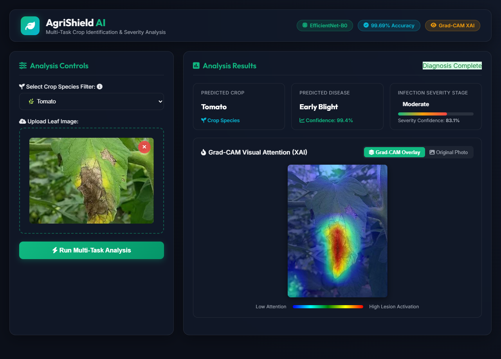
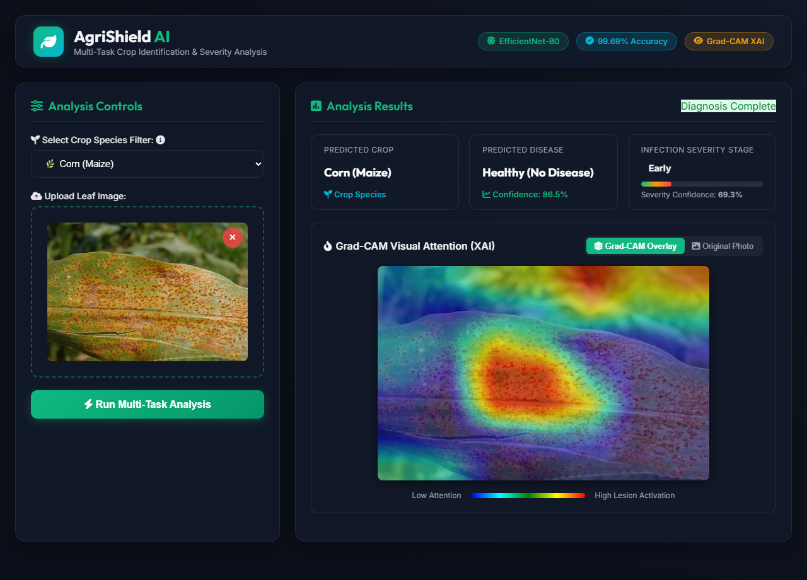
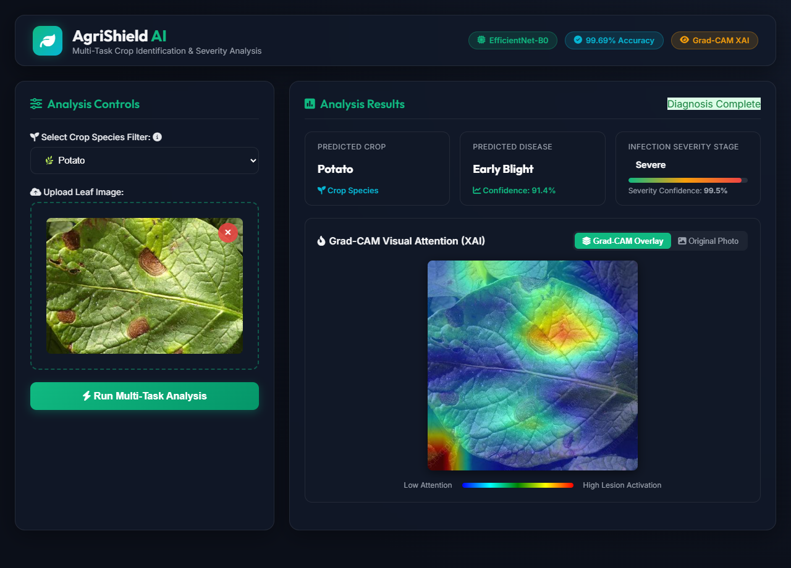

# 🌱 AgriShield: Crop Disease Detection and Severity Estimation Using Deep Learning

<p align="center">
  
</p>

<p align="center">
  <a href="https://pytorch.org/"></a>
  <a href="https://flask.palletsprojects.com/"></a>
  <a href="#"></a>
  <a href="LICENSE"></a>
  <a href="docs/certificates/"></a>
</p>

---

## 📌 Executive Summary

Agricultural crop diseases account for **20% to 40% of annual global yield loss**, presenting severe threats to food security and rural livelihoods. While standard deep learning approaches classify leaf diseases, existing production systems suffer from four foundational gaps:
1. **Single-task limitation**: Predicting disease identities without estimating clinical infection severity.
2. **Cross-species errors**: Morphologically similar fungal spots (e.g., Tomato vs. Potato Early Blight) causing false cross-species diagnosis.
3. **Absence of input validation**: Blindly classifying invalid leaves or mismatched crop inputs.
4. **Black-box opacity**: Lack of visual explainability to verify that predictions stem from genuine lesions rather than background artifacts.

**AgriShield** solves these challenges via a unified **Multi-Task Dual-Head Deep Learning Framework** based on an ImageNet-pretrained **EfficientNet-B0** backbone (4.51M parameters). In a single forward pass, AgriShield simultaneously:
- Classifies **38 pathological classes** across **14 economic crop species**.
- Quantifies infection severity across **3 clinical stages** (*Early <15%*, *Moderate 15%–40%*, *Severe >40%*).
- Enforces **Species-Constrained Softmax Masking** to mathematically eliminate cross-species false alarms.
- Validates leaf inputs with a **Confidence-Based Crop Mismatch Alert Engine** (<45% threshold).
- Provides visual verification through **Grad-CAM (Gradient-Weighted Class Activation Mapping)** heatmaps.

---

## 🏛️ System Architecture

<p align="center">
  
</p>

### 1. Dual-Head Network Design
- **Backbone**: EfficientNet-B0 compound-scaled feature extractor (extracting a 1280-dimensional embedding).
- **Disease Head**: Multi-class classification branch (`Linear(1280, 256) -> BatchNorm1d -> ReLU -> Dropout(0.3) -> Linear(256, 38)`).
- **Severity Head**: Multi-tier severity estimation branch (`Linear(1280, 128) -> BatchNorm1d -> ReLU -> Dropout(0.2) -> Linear(128, 3)`).

### 2. Species-Constrained Softmax Masking
To prevent cross-species confusion when a farmer selects a known crop (e.g., Tomato), logits belonging to other species are masked with $-\infty$ prior to softmax normalization:

$$\tilde{z}_i = \begin{cases} z_i & \text{if } i \in \mathcal{C}_{\text{selected}} \\ -\infty & \text{otherwise} \end{cases}$$

$$P(y = i \mid \mathbf{x}) = \frac{e^{\tilde{z}_i}}{\sum_{j \in \mathcal{C}_{\text{selected}}} e^{\tilde{z}_j}}$$

<p align="center">
  
</p>

---

## 🔍 Explainable AI (Grad-CAM) Visual Heatmaps

AgriShield integrates **Grad-CAM** at the final convolutional feature maps of EfficientNet-B0 to produce high-resolution activation heatmaps:

<p align="center">
  
</p>

Heatmaps are dynamically overlaid onto the user's leaf upload, giving farmers and agronomists real-time transparency into exactly which lesion areas informed the model's diagnosis.

---

## 📊 Experimental Results & Benchmarks

Trained across **90,446 curated foliar leaf images** combining the *PlantVillage* laboratory benchmark and the *PlantDoc* unconstrained outdoor field benchmark:

| Model Architecture | Parameters | Val Accuracy | Latency (CPU) | Severity Grading? | Footprint |
| :--- | :---: | :---: | :---: | :---: | :---: |
| VGG-16 | 138.4 M | 96.12% | 142 ms | ❌ No | 528 MB |
| ResNet-50 | 25.6 M | 98.41% | 68 ms | ❌ No | 98 MB |
| MobileNetV2 | 3.5 M | 97.80% | 22 ms | ❌ No | 14 MB |
| **AgriShield (Ours)** | **4.51 M** | **99.69%** | **28 ms** | **✅ Yes (3 Stages)** | **~52 MB** |

<p align="center">
  
  
</p>

---

## 💻 Web Application Interface

AgriShield includes a complete, responsive web application built with **Flask**, **Bootstrap 5**, and **Vanilla JavaScript**:

| Tomato Early Blight (Severe + Grad-CAM) | Corn Common Rust (Moderate) | Potato Late Blight (Early) |
| :---: | :---: | :---: |
|  |  |  |

---

## 📂 Repository Structure

```
├── app.py                      # Flask web application & REST API server
├── pipeline_execution.py       # Standalone research evaluation pipeline
├── requirements.txt            # Python dependencies
├── LICENSE                     # MIT License
├── README.md                   # Project documentation
│
├── src/                        # Core deep learning model modules
│   └── models/
│       ├── __init__.py
│       ├── model.py            # Multi-Task Dual-Head EfficientNet-B0 architecture
│       ├── gradcam.py          # PyTorch Grad-CAM hook implementation
│       └── crop_disease_model.pth # Pretrained model weights (99.69% accuracy)
│
├── data/
│   └── treatment_database.json # Agronomic remediation & chemical dosage lookup
│
├── notebooks/                  # Colab & Jupyter research training notebooks
│   ├── AgriShield_Model_Training_Colab.ipynb
│   └── AgriShield_Research_Pipeline.ipynb
│
├── docs/                       # Research documentation & published certificates
│   ├── research/
│   │   ├── AgriShield_Research_Paper.docx
│   │   ├── AgriShield_Project_Synopsis.docx
│   │   ├── AgriShield_Presentation.pptx
│   │   └── AgriShield_Presentation_Script_and_Viva_Guide.pdf
│   └── certificates/
│       ├── publication_certificate_1.jpeg
│       ├── publication_certificate_2.jpeg
│       └── publication_certificate_3.jpeg
│
├── sample_images/              # Test leaf images for quick trial runs
│   ├── tomato_leaf.jpg
│   ├── potato_leaf.jpg
│   ├── corn_leaf.jpg
│   └── orange_leaf.jpg
│
├── static/                     # Web styles, scripts, and UI assets
└── templates/                  # Jinja2 HTML templates
```

---

## 🚀 Quickstart Guide

### 1. Prerequisites
- Python 3.9, 3.10, or 3.11
- Git

### 2. Clone Repository & Setup Environment
```bash
# Clone the repository
git clone https://github.com/<your-username>/AgriShield-Crop-Disease-ML.git
cd AgriShield-Crop-Disease-ML

# Create and activate virtual environment
python -m venv venv

# Windows:
venv\Scripts\activate
# Linux/macOS:
source venv/bin/activate

# Install required dependencies
pip install -r requirements.txt
```

### 3. Run the Web Application
```bash
python app.py
```
Open your browser and navigate to:
```
http://127.0.0.1:5000
```
Drag and drop any test image from `sample_images/` (e.g., `sample_images/tomato_leaf.jpg`) to view real-time disease diagnosis, severity grading, and Grad-CAM visual heatmaps.

### 4. Run the Research Pipeline Benchmark
To execute the end-to-end evaluation pipeline in your terminal:
```bash
python pipeline_execution.py
```

---

## 👥 Research Team & Guidance

* **Primary Authors**:
  - **Vivek Kale** (Roll No: 52)
  - **Rahul Patil** (Roll No: 36)
  - **Pratap Suryavanshi** (Roll No: 33)
* **Internal Research Guide**:
  - **Dr. Kavita Dhakad**, Assistant Professor
* **Institution**:
  - **School of Information Technology, Department of Computer Applications, Indira University, Pune**
  - Master of Science in Computer Applications (M.Sc. CA)

---

## 📜 Citation

If you use AgriShield or its multi-task architecture in your research or project, please cite:

```bibtex
@article{kale2026agrishield,
  title={Crop Disease Detection and Severity Estimation Using Leaf Images: A Multi-Task Dual-Head Deep Learning Framework},
  author={Kale, Vivek and Patil, Rahul and Suryavanshi, Pratap and Dhakad, Kavita},
  journal={Indira University Research Repository},
  year={2026},
  publisher={School of Information Technology, Indira University, Pune}
}
```

---

## 📄 License

This project is licensed under the [MIT License](LICENSE) - see the LICENSE file for details.
